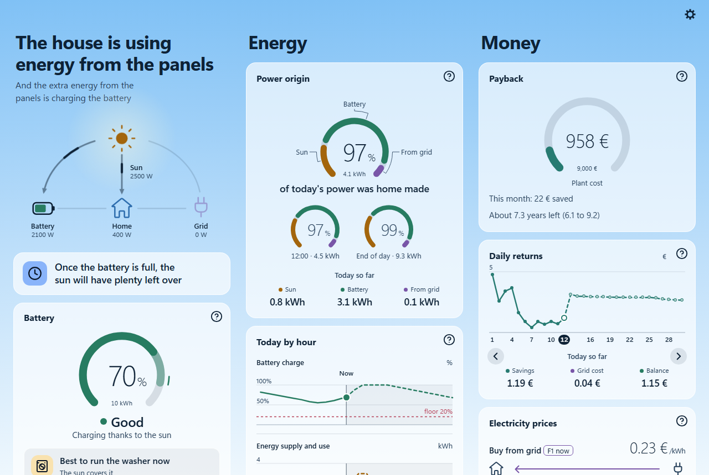
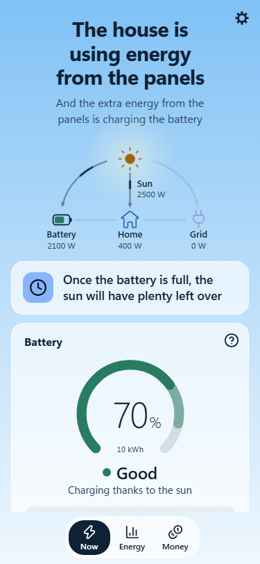
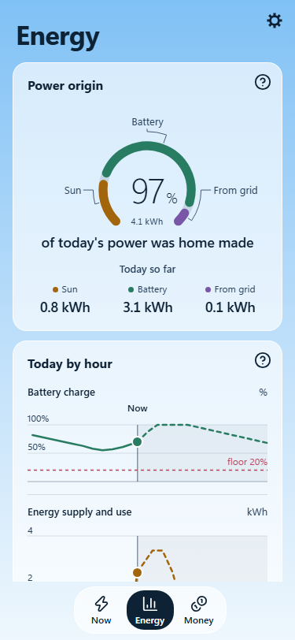
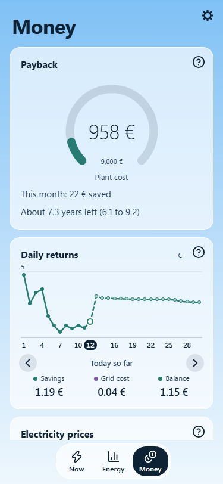

# ha-solar-view

Your solar system in plain words, as a page in Home Assistant.

Most solar dashboards are for whoever installed the system. This one is for everyone else. It says "The house is using energy from the panels" instead of showing watts, calls the battery "Low", "Good" or "Full" next to its percent, says how long it will power the house (from the solar forecast and your usual day, hour by hour), and gives one line of advice that follows the moment: "Dishes to wash? The sun is ready!" when there is sun to spare, a warning when the battery runs low, a hint to wait when tomorrow looks sunnier. A separate line says when to start the washer. You can add [advice lines of your own](docs/setup.md#your-own-advice-lines).

Any brand works, because it reads Home Assistant's own Energy settings. Three pages: **Now** (the house right now, the battery and the coming days), **Energy** (today hour by hour and a year of production) and **Money** (payback, daily returns, prices and the month balance). Swipe between them on a phone; on a wide screen they stand side by side. Light and dark. 8 languages (en, it, es, fr, de, pt, nl, pl) and a 12 or 24 hour clock, following each user's profile. Big phone text gets a layout of its own.

Plain files, no build step, no dependencies. Installs and updates through HACS. No data leaves your Home Assistant.



On a phone, one page at a time:

<p>
  
  
  
</p>

[All screenshots](docs/screenshots.md), dark theme and the sky at dawn, midday, dusk and night included.

## Quick start

1. In HACS, add `https://github.com/L9Tigrotto/ha-solar-view` as a custom repository of type **Dashboard**, then download **Solar View**.
2. Add to `configuration.yaml`:

   ```yaml
   panel_custom:
     - name: solar-view
       url_path: solar
       sidebar_title: Solar
       sidebar_icon: mdi:solar-power-variant
       module_url: /hacsfiles/ha-solar-view/solar-view.js
   ```

3. Restart Home Assistant.

You need the Energy dashboard set up with a power sensor for the solar panels. A grid power sensor, a battery, prices and a solar forecast are optional: each turns on more of the page. Options, install by hand, a FAQ and troubleshooting are in the [setup guide](docs/setup.md).

## More

- [Setup guide](docs/setup.md): install, options, prediction levels, FAQ, troubleshooting.
- [How it works](docs/how-it-works.md): how each forecast, figure and advice line is worked out.
- [Screenshots](docs/screenshots.md): every page, light and dark, phone and desktop.
- [Development](docs/development.md): the preview tool, its checks, testing a local copy, adding a language.

Translations other than Italian were not checked by a native speaker. Corrections are welcome.

## Licence

MIT, see [LICENSE](LICENSE). Accent colours from [Catppuccin](https://github.com/catppuccin/catppuccin). Icons from [Lucide](https://lucide.dev) (ISC and MIT, notices at the end of `dist/solar-view.js`).
