# Screenshots

All taken from the [preview tool](development.md) with made-up numbers and the past days of a real house. The page is shown in English, at 11:00 on a sunny day, with every prediction on.

## Desktop

On a wide screen the three pages stand side by side.

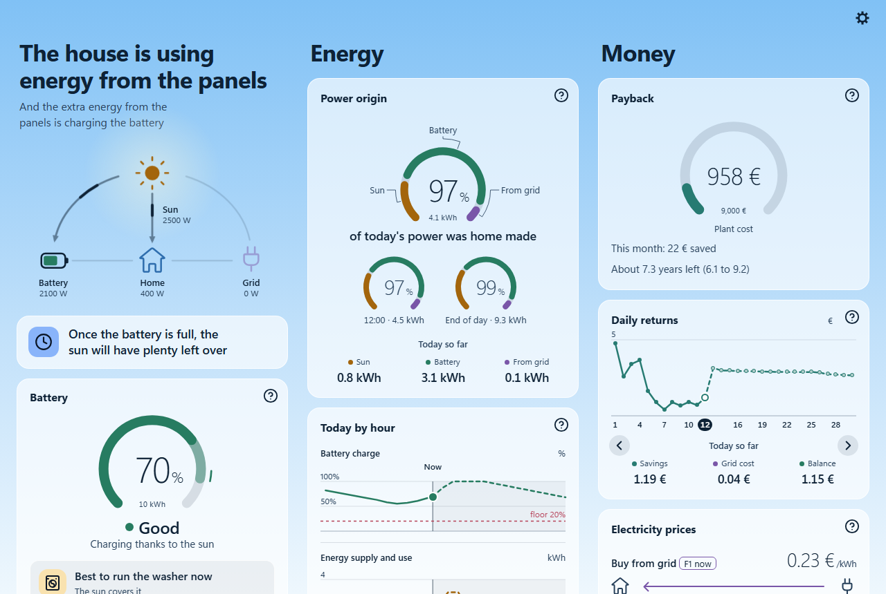

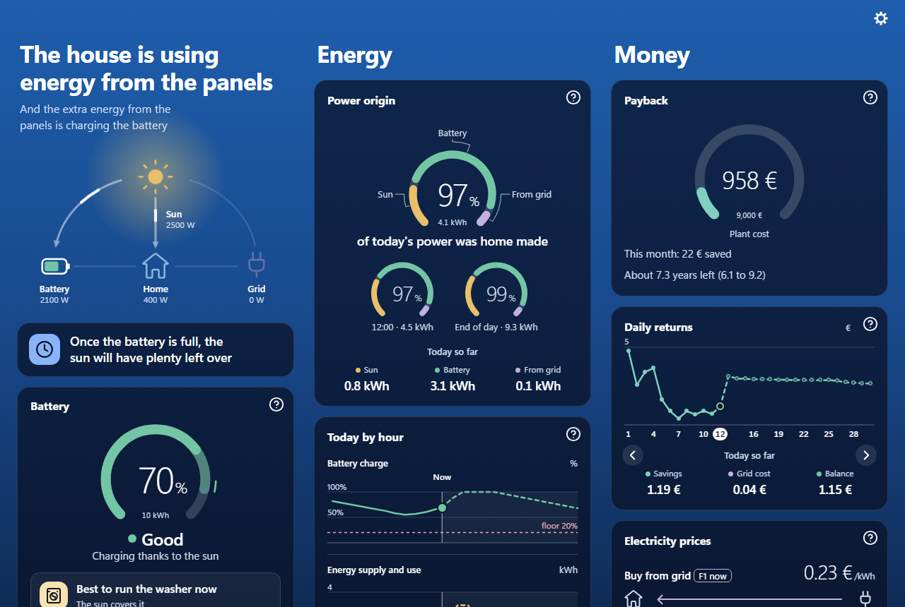

## Phone, light theme

  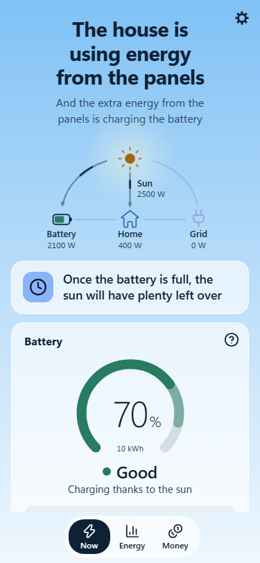
  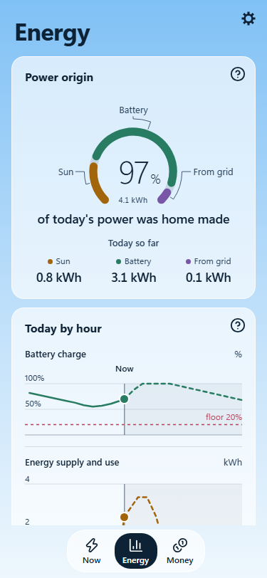
  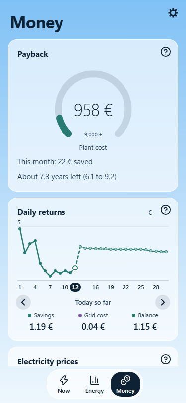

## Phone, dark theme

  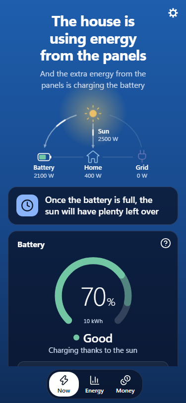
  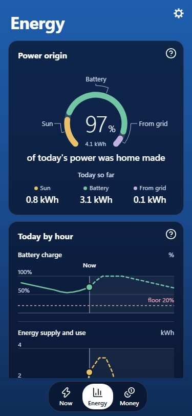
  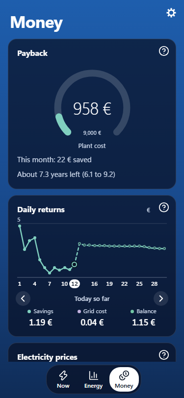

## The sky

The sky is not part of the theme: it follows the real height of the sun. The same dark theme at dawn, midday, dusk and night:

  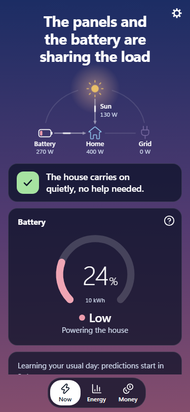
  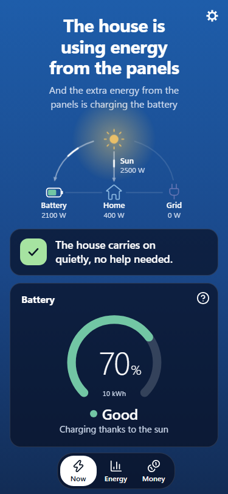
  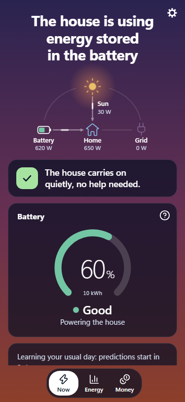
  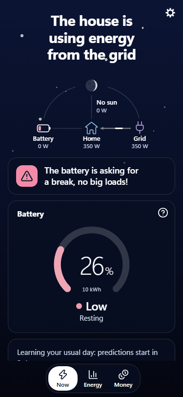

## Taking them again

Each shot is the preview opened with `?shot=1`, which hides the tool's own controls. The pages use `/preview/?shot=1&lang=en&scenario=midday&fc=learned_weather&weather=sunny&at=2026-11-12T11:00`, plus `&dark=0` or `&dark=1` and `&page=now`, `energy` or `money`. Phone shots are 375 x 812 CSS pixels, desktop shots 1280 x 860. The sky shots use the scenarios `dawn`, `midday`, `dusk` and `night` with `dark=1`, an `at` time of that part of the day, and the scenario's own `elev` and `rising`.

Use a browser that can set the exact viewport (the device toolbar of the developer tools, or a headless browser driven through the DevTools protocol). A headless window set to 375 pixels wide may still lay out the page wider.
